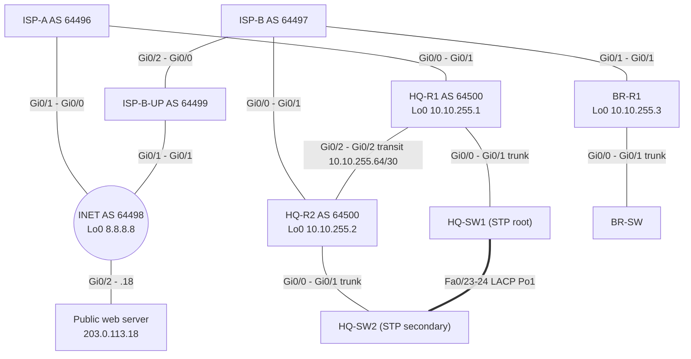

# Topology

Source diagram: build this in draw.io (diagrams.net) with the interface names below, then export `docs/images/topology.png` and keep the `.drawio` file next to it. The Mermaid version renders on GitHub and doubles as a reference.

## Link table

| Link | Side A | Side B | Type |
|---|---|---|---|
| HQ-R1 to HQ-SW1 | HQ-R1 Gi0/0 | HQ-SW1 Gi0/1 | trunk (subinterfaces) |
| HQ-R2 to HQ-SW2 | HQ-R2 Gi0/0 | HQ-SW2 Gi0/1 | trunk (subinterfaces) |
| HQ-SW1 to HQ-SW2 | Fa0/23-24 | Fa0/23-24 | LACP Po1 trunk |
| HQ-R1 to HQ-R2 | Gi0/2 | Gi0/2 | routed transit, OSPF |
| HQ-R1 to ISP-A | HQ-R1 Gi0/1 | ISP-A Gi0/0 | eBGP |
| HQ-R2 to ISP-B | HQ-R2 Gi0/1 | ISP-B Gi0/0 | eBGP |
| BR-R1 to ISP-B | BR-R1 Gi0/1 | ISP-B Gi0/1 | static default (VPN in Phase 6) |
| BR-R1 to BR-SW | BR-R1 Gi0/0 | BR-SW Gi0/1 | trunk (subinterfaces) |
| ISP-A to INET | ISP-A Gi0/1 | INET Gi0/0 | eBGP |
| ISP-B to ISP-B-UP | ISP-B Gi0/2 | ISP-B-UP Gi0/0 | eBGP |
| ISP-B-UP to INET | ISP-B-UP Gi0/1 | INET Gi0/1 | eBGP |
| INET to web server | INET Gi0/2 | server NIC | routed |

## Routing at a glance

- OSPF process 1, area 0: HQ-R1 and HQ-R2 only (HQ subnets, loopbacks, transit). Branch is not in OSPF.
- BGP: each HQ router runs eBGP only to its own ISP. Packet Tracer 9 does not support iBGP. Loopbacks are router IDs only.
- BGP is never redistributed into OSPF.
- Inbound: INET prefers ISP-A for 192.0.2.0/24 because the ISP-B path (through ISP-B-UP, AS 64499) is one AS hop longer.
- Outbound: HQ-R1 is the HSRP active router and uses ISP-A. If ISP-A is lost, a floating static default (AD 250) on HQ-R1 sends traffic across the transit link to HQ-R2 and out ISP-B.
- Packet Tracer has no route-map, weight, local-pref, update-source, default-originate or iBGP, so none of them are used.
